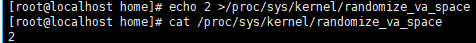

# Redis 7.0.15 Floating-Point Type Acceleration Feature Guide

<!-- md-trans-meta sourceCommit=3fd807ef3a384848b68cb604076163d72b4e873d translatedAt=2026-08-17T09:53:19.740Z pushedAt=2026-08-20T03:39:55.552Z -->

## Feature Description

### Overview

This document describes how to switch glibc's built-in floating-point printing algorithm to the grisu2 algorithm in Redis 7.0.15 on the new Kunpeng 920 processor model or Kunpeng 950 processor running openEuler, aiming to boost floating-point printing performance.

### Constraints

**Impact on the System**

This feature switches glibc's built-in floating-point printing algorithm to the grisu2 algorithm in Redis 7.0.15, solely to improve printing performance. It has no impact on the existing system service logic, and does not change the external interfaces or behavior of Redis.

**Restrictions**

- Mapping between OSs and processors: openEuler 22.03 LTS SP4 corresponds to the new Kunpeng 920 processor model, and openEuler 24.03 LTS SP3 corresponds to the Kunpeng 950 processor.

- Redis 7.0.15 is mandatory, with the grisu2 for double2string optimization patch (`0003-adapt-grisu2-for-double2string.patch`) being applied.

**Feature Interactions**

None.

### Application Scenarios

This feature applies to Redis 7.0.15 deployed on the Arm platform (new Kunpeng 920 processor model or Kunpeng 950 processor). It boosts the performance of floating-point printing via algorithm optimization. Its typical application scenario includes:

- `zrange` test on Redis 7.0.15 running as a single instance with NUMA binding on a physical machine.

### Principles

This feature switches Redis 7.0.15's floating‑point printing algorithm from glibc's dragon4 to grisu2, replacing bignum arithmetic operations with ordinary division and table lookup for improved performance.

## Software Deployment/Installation

### Environment Requirements

This document provides guidance based on the new Kunpeng 920 processor model, Kunpeng 950 processor, and openEuler OS. Before performing operations, ensure that your hardware and software meet the requirements.

**Hardware Requirements**

Table 1 lists the hardware requirement for each node in the cluster.

**Table 1** Hardware requirement

| Item | Specifications |
| ---- | ---- |
| CPU  | New Kunpeng 920 processor model or Kunpeng 950 processor |

**OS and Software Requirements**

Table 2 lists the software requirements for each node in the cluster.

**Table 2** OS and software requirements<a id="section10405204515189"></a>

| Item | Version | Remarks |
| ---- | ---- | ---- |
| OS | openEuler 22.03 LTS SP4 | Corresponding to the new Kunpeng 920 processor model |
| OS | openEuler 24.03 LTS SP3 | Corresponding to the Kunpeng 950 processor |
| Container | Docker AArch64 | Matching the OS |
| Redis | 7.0.15 |  |
| memtier-benchmark | 2.1.4 |  |
| double2string optimization patch | <code>0003-adapt-grisu2-for-double2string.patch</code> |

## Feature Usage

This document uses the new Kunpeng 920 processor model and openEuler 22.03 LTS SP4 as an example to describe how to enable floating-point type acceleration.

### Feature Compilation and Enablement

To enable the floating-point type acceleration feature on Redis 7.0.15, you need to apply the grisu2 for double2string optimization patch and then compile Redis.

1. Download the required dependencies.

   ```bash
   yum -y install wget git vim tar make gcc gcc-c++ libatomic texinfo libtool autoconf automake pkgconf openssl-devel zlib-devel
   ```

2. Download the source code of Redis 7.0.15.

3. Move `0003-adapt-grisu2-for-double2string.patch` in the Redis repository to the Redis source code directory, and apply the patch.

   ```bash
   git clone https://gitcode.com/BoosKit/Redis.git
   cd Redis
   cp 0003-adapt-grisu2-for-double2string.patch path/redis-7.0.15
   cd path/redis-7.0.15
   patch -p1 < 0003-adapt-grisu2-for-double2string.patch
   ```

4. Recompile Redis 7.0.15.

   ```bash
   cd path/redis-7.0.15
   make distclean
   make -j
   ```

5. Download the memtier_benchmark 2.1.4 source code and compile it.

   ```bash
   git clone https://github.com/RedisLabs/memtier_benchmark.git
   cd memtier_benchmark
   git checkout 2.1.4
   autoreconf -ivf
   ./configure
   make -j
   ```

## Feature Verification

This document uses a single Redis 7.0.15 instance running on a physical machine, with local loopback and NUMA binding, as an example to verify the feature.

### Baseline Test

1. Start the redis-server.

   ```bash
   numactl --cpunodebind=1  redis-7.0.15/src/redis-server  --maxmemory 20G --maxmemory-policy allkeys-lru --port 6379  --protected-mode no --appendonly no
   ```

2. Preload data.

   Use memtier_benchmark for stress testing.

   Data must be preloaded before stress testing. The `prepare_data.py` reference script is as follows:

   ```python
   #!/usr/bin/env python3
   # -*- coding: utf-8 -*-
   import subprocess
   REDIS_HOST = "127.0.0.1"
   REDIS_PORT = "6379"
   KEY_PREFIX = "zset:field-max_1000:redis:"
   KEY_MIN = 0
   KEY_MAX = 2000

   REQUESTS_PER_CLIENT = 20000
   PAIRS_PER_REQ = 10

   FIELD_MIN = 1
   FIELD_MAX = 1000
   FIELD_RANGE = FIELD_MAX - FIELD_MIN + 1

   SCORE_MIN = 0
   SCORE_MAX = 10000                 
   SCORE_RANGE = SCORE_MAX - SCORE_MIN + 1

   def gen_one_key(key_id: int):
      """
      Derive the final member/score left for a key based on the "sequential trace of a single client".
      Logical basis:
      1. Keys are generated in sequential mode.
      2. Each client sends 20,000 requests in total.
      3. Each request writes 10 groups of scores/members.
      4. For duplicate members, only the score is updated and the cardinality does not increase.
      """
      final= {}
      num_keys =KEY_MAX - KEY_MIN + 1
      #For a single client, the request sequence number is r=0...19999.
      #If keys rotate in order, the requests that hit this key satisfy: r % num_keys == key_id.
      r = key_id - KEY_MIN
      while r < REQUESTS_PER_CLIENT:
         base_pair_idx = r * PAIRS_PER_REQ

         for t in range(PAIRS_PER_REQ):
            global_pair_idx = base_pair_idx + t

            #field/member advances sequentially and wraps around after reaching the upper limit.
            field_id = FIELD_MIN + (global_pair_idx % FIELD_RANGE)

            #score advances sequentially and wraps around after reaching the upper limit.
            score = SCORE_MIN + (global_pair_idx % SCORE_RANGE)
            member = f"field:{field_id}"

            #If a member is duplicated, the later write overwrites the earlier one, matching Redis ZADD semantics.
            final[member] = score
         r += num_keys
      return final

   def main():
      proc = subprocess.Popen(
         ["redis-cli", "-h", REDIS_HOST, "-p", REDIS_PORT, "--pipe"],
         stdin=subprocess.PIPE,
         text=True
      )

      for key_id in range(KEY_MIN,KEY_MAX+1):
         key = f"{KEY_PREFIX}{key_id}"

         #Delete the old key first to avoid interference from historical data.
         proc.stdin.write(f"DEL {key}\n")
         final= gen_one_key(key_id)
         if final:
            parts =[f"ZADD {key}"]
         #Sort by field number for stable output.
         for member in sorted(final.keys(),key=lambda x:int(x.split(":")[1])):
            parts.append(str(final[member]))
            parts.append(member)
         proc.stdin.write(" ".join(parts) + "\n")

      proc.stdin.close()
      ret = proc.wait()
      if ret!= 0:
         raise SystemExit(ret)
      print("Data preloading completed.")

   if __name__ == "__main__":
      main()
   ```

3. Run the stress test and record the QPS.

   ```bash
   numactl --cpunodebind=1 memtier_benchmark/memtier_benchmark \
   --server=127.0.0.1 \
   --port=6379 \
   --threads=8 \
   --clients=50 \
   --test-time=360 \
   --key-prefix=zset:field-max_1000:redis: \
   --key-maximum=2000 \
   --command="zrange __key__ 0 -1 withscores" \
   --command-key-pattern=S
   ```

4. Repeat the stress test and take the average value.

### Performance Test

Replace the redis-server in the baseline with the optimized one, and keep the other steps consistent with those of the baseline test.

Run the stress test multiple times, record the QPS for each run, and compute the average. Then compare the average QPS before and after the optimization.

## Security Check and Hardening

Address space layout randomization (ASLR) is a security technology against buffer overflow. It randomizes the layout of linear areas such as heap, stack, and shared library mapping to make it difficult for attackers to predict target addresses and directly locate code, thereby preventing overflow attacks.

```bash
echo 2 >/proc/sys/kernel/randomize_va_space
```



## Change History

| Date | Description |
| ---- | ---- |
| 2026-09-30 | This is the first official release. |
