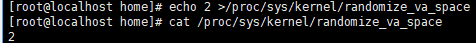

# Redis CRC16 PMULL优化 特性指南

本文档介绍Redis 7.0.15 CRC16/XMODEM的PMULL优化特性，利用PMULL无进位乘法与NEON向量运算批处理数据并按输入长度选择计算路径，适用于在鲲鹏920新型号处理器和openEuler 22.03 LTS SP4上使能该特性并完成性能验证的用户。

## 特性描述

### 简介

本文介绍Redis 7.0.15 CRC16 PMULL优化原理、环境要求、安装接入和验证方法。CRC16是一类输出16位校验值的循环冗余校验算法，XMODEM是Redis采用的CRC16参数方案，PMULL是用于加速该算法多项式运算的无进位乘法指令。本特性保持CRC16/XMODEM的计算结果不变，仅优化其计算实现。原有CRC16实现逐字节查表更新状态，存在串行依赖。优化利用PMULL无进位乘法及NEON向量运算处理数据，并根据输入长度和运行时指令集能力选择短输入、PMULL、八路NEON或SVE计算路径；不满足优化条件时使用标量实现。

### 原理描述

原有CRC16算法逐字节查表计算，每处理一个字节都需要等待上一个字节的计算结果，输入数据较长时，这种串行处理方式会限制计算效率。PMULL优化利用CRC16的多项式运算特性，通过无进位乘法和异或运算批量处理数据，减少逐字节更新带来的依赖。

满足运行时指令集条件时，优化实现按输入长度分派计算路径。以下为Redis调用CRC16入口、初始校验值为0时的路径。

**表1 输入长度与计算路径**

| 输入长度 | 计算路径 |
| --- | --- |
| 小于8B | 标量查表实现 |
| 8B～15B | 短输入多项式计算实现 |
| 16B～127B | 短输入汇编实现，其中16B和64B使用专用快速路径 |
| 128B～4095B | PMULL实现 |
| 4096B～16383B | 八路NEON实现 |
| 16384B及以上 | 满足SVE运行条件时优先选择SVE实现，否则使用八路NEON实现 |

运行时检查PMULL能力；启用SHA3构建时还要求SHA3能力，不满足时回退到标量实现。SVE路径还要求SVE、SVE2和SVEPMULL能力，汇编入口在向量长度不是256位时回退到NEON实现。各路径保持CRC16/XMODEM计算结果一致。

## 已验证环境

本指南基于以下环境进行说明。部署前，请确认目标环境的硬件配置及软件版本满足相应要求。

**表2 硬件要求**

| 项目 | 说明 |
| --- | --- |
| CPU | 鲲鹏920新型号处理器；Linux ARM64小端环境。默认构建的基础优化要求PMULL和SHA3，SVE路径另需SVE、SVE2、SVEPMULL能力和256位向量长度。 |

部署前在目标宿主机执行`lscpu`，核对架构为`aarch64`，并检查指令集标志中的`pmull`、`sha3`及所需的SVE能力；不能仅凭处理器系列名称判断指令集是否满足。当前接入补丁将基础优化与SVE路径分别判断：缺少默认构建所需的PMULL或SHA3时回退标量实现；缺少SVE条件时不选择SVE路径，但不影响满足条件的PMULL/NEON路径。构建或启动成功不代表已进入优化路径，不能将标量回退测试结果作为优化性能结论。

<a id="操作系统和软件要求"></a>

**表3 操作系统和软件要求**

| 项目 | 版本或用途 | 获取方式 |
| --- | --- | --- |
| 操作系统 | openEuler 22.03 LTS SP4 | [openEuler 22.03 LTS SP4下载页面](https://www.openeuler.org/zh/download/archive/detail/?version=openEuler%252022.03%2520LTS%2520SP4) |
| Redis | 7.0.15 | [Redis 7.0.15源码包下载](https://download.redis.io/releases/redis-7.0.15.tar.gz) |
| Redis 接入补丁 | 0001-crc16-adapt.patch | [Redis 7.0.15 CRC16接入补丁下载](https://gitcode.com/boostkit/Redis/blob/master/src/Redis-7.0.15/feature-patches/0001-crc16-adapt.patch) |

## 安装和使用特性

以下命令均在目标服务器的宿主机上使用Bash执行。安装软件包需使用root权限；源码下载、构建和后续测试请使用同一用户，`$HOME`表示该用户的主目录。开始前，请确认`$HOME/redis_baseline`和`$HOME/redis_opt`不存在，避免覆盖已有文件。

1. 安装基础编译工具及相关依赖。

   ```bash
   yum -y install wget make gcc patch
   ```

2. 下载Redis 7.0.15源码并解压到`$HOME`目录。

   ```bash
   cd $HOME
   wget https://download.redis.io/releases/redis-7.0.15.tar.gz
   tar -xzf redis-7.0.15.tar.gz
   mv redis-7.0.15 redis_baseline
   cp -a redis_baseline redis_opt
   ```

3. 获取Redis CRC16 PMULL补丁，并将补丁文件上传至目标服务器的`$HOME/redis_opt`目录。
   下载地址参见[表3 操作系统和软件要求](#操作系统和软件要求)。

4. 构建基线版和优化版Redis。

   先在`redis_baseline`中构建未修改的基线版本，再在`redis_opt`中应用补丁并构建优化版本。

   接入补丁默认设置`CRC16_PMULL=yes`、`CRC16_SHA3=yes`、`CRC16_SVE=yes`。编译工具链需能汇编所启用的指令，默认基础优化的运行时要求为PMULL和SHA3，SVE另按前述条件分派。若目标仅满足PMULL/NEON条件而不具备SHA3或SVE，可在优化目录先执行`make distclean`，再使用`make -j CRC16_SHA3=no CRC16_SVE=no`重新构建；修改构建开关后必须清理旧产物。该降级构建与默认构建的路径不同，性能需单独验证。无需额外的Redis运行配置开关。

   ```bash
   cd $HOME/redis_baseline
   make -j

   cd $HOME/redis_opt
   patch -p1 < 0001-crc16-adapt.patch
   make -j
   ```

   两个目录分别保留基线和优化产物。若需撤销接入补丁，先停止优化实例，再在宿主机执行以下命令；回退后必须清理并重新构建，不能继续使用旧的优化二进制。

   ```bash
   cd $HOME/redis_opt
   patch -R -p1 < 0001-crc16-adapt.patch
   make distclean
   make -j
   ```

## 验证特性

### 准备测试容器

   请先在宿主机安装并启动Docker，确保当前用户有权执行Docker命令。以下示例假设已准备名为`openeuler-22.03-lts-sp4`的本地ARM64镜像，容器需包含Bash、`taskset`（由util-linux提供）及运行宿主机构建的Redis二进制所需的动态库。镜像名为本地示例，不是可直接拉取的官方镜像地址。

   若通过离线镜像包交付环境，请先执行`docker load -i /实际路径/镜像包.tar`，再用`docker image ls`确认导入后的镜像名称和标签，并替换下方`docker run`中的示例镜像名。镜像包路径需替换为实际文件，导入成功后再创建容器；`docker run`同时完成容器创建和启动。

   CPU 10和NUMA节点0仅为示例。请先使用`lscpu`核对宿主机可用CPU及其所属NUMA节点，并同步替换`--cpuset-cpus`、`--cpuset-mems`和后续`taskset -c`中的编号。

   容器使用host网络，因此宿主机测试命令可访问容器中绑定的`127.0.0.1:6379`。请先确认该端口未被其他服务占用。以下特权容器、关闭Redis保护模式和重置集群的命令仅用于隔离的测试环境，不得对生产实例或已有业务数据执行。

   使用两个终端：终端A进入容器执行服务端命令；终端B保留在宿主机上执行key生成和性能测试命令。

   ```bash
   # 在宿主机执行，将源码目录挂载到固定的容器路径。
   docker run --cpus=1 --cpuset-cpus=10 --cpuset-mems=0 --network host --privileged=true -itd --name redis-docker-1c1t \
       -v "$HOME/redis_baseline:/work/redis_baseline" \
       -v "$HOME/redis_opt:/work/redis_opt" \
       openeuler-22.03-lts-sp4 /bin/bash
   docker exec -it redis-docker-1c1t /bin/bash
   ```

### 测试基线版本

   先测试基线版本，再测试优化版本。两次测试使用相同的CPU绑定、客户端数、请求数和key。启动Redis并不代表优化路径已使能，需先确认目标处理器满足前述运行时指令集条件；否则可能回退到标量实现。

1. 在终端A（容器内）以集群模式启动基线Redis。

   ```bash
   cd /work/redis_baseline
   # CPU 10为示例，请替换为实际绑定的CPU核心序号。
   taskset -c 10 ./src/redis-server \
         --bind 127.0.0.1 \
         --protected-mode no \
         --daemonize yes \
         --save "" \
         --appendonly no \
         --cluster-enabled yes \
         --cluster-config-file nodes.conf

   ./src/redis-cli cluster reset
   ./src/redis-cli cluster addslots {0..16383}
   ./src/redis-cli cluster slots
   ```

   `cluster reset`和`cluster addslots`预期返回`OK`，`cluster slots`应显示槽位范围覆盖0～16383。若返回连接失败或槽位分配错误，请先排查服务状态及已有集群配置，不要继续压测。

2. 在终端B（宿主机）生成64B的测试key。

   本例未向Redis写入该key对应的值，GET请求用于测试集群模式下包含key哈希槽计算的未命中请求吞吐量，不代表业务缓存命中场景。64B key对应前述短输入快速路径，不能覆盖全部长度的计算路径。

   ```bash
   cd $HOME
   mkdir -p keys
   head -c 64 /dev/zero | tr '\0' 'k' > "keys/key_64.bin"
   ```

3. 在终端B（宿主机）执行测试命令。

   ```bash
   cd $HOME/redis_baseline
   ./src/redis-benchmark \
         -h 127.0.0.1 \
         -p 6379 \
         -c 200 \
         -n 1000000000 \
         -P 16 \
         -x GET \
         < "$HOME/keys/key_64.bin"
   ```

### 测试优化版本

1. 确认基线测试结束后，在终端A（容器内）停止基线Redis服务，并启动优化版本。

   ```bash
   cd /work/redis_baseline
   ./src/redis-cli shutdown
   cd /work/redis_opt
   taskset -c 10 ./src/redis-server \
         --bind 127.0.0.1 \
         --protected-mode no \
         --daemonize yes \
         --save "" \
         --appendonly no \
         --cluster-enabled yes \
         --cluster-config-file nodes.conf

   ./src/redis-cli cluster reset
   ./src/redis-cli cluster addslots {0..16383}
   ./src/redis-cli cluster slots
   ```

   `cluster reset`和`cluster addslots`预期返回`OK`，`cluster slots`应显示槽位范围覆盖0～16383。若返回连接失败或槽位分配错误，请先排查服务状态及已有集群配置，不要继续压测。

2. 服务启动并完成槽位分配后，在终端B（宿主机）执行测试命令，复用基线测试生成的64B key。

   ```bash
   cd $HOME/redis_opt
   ./src/redis-benchmark \
         -h 127.0.0.1 \
         -p 6379 \
         -c 200 \
         -n 1000000000 \
         -P 16 \
         -x GET \
         < "$HOME/keys/key_64.bin"
   ```

### 结果比对说明

   确认两次测试均完成设定请求数，且未出现连接错误或`CLUSTERDOWN`等错误。记录redis-benchmark输出的GET吞吐量（requests per second，即每秒请求数），两个版本使用相同的重复次数分别取平均值。

   提升比例为（优化版平均吞吐量－基线版平均吞吐量）/基线版平均吞吐量×100%。确保两次测试使用相同的CPU绑定、客户端数、请求数和key。

   在该测试环境及负载条件下，启用Redis CRC16 PMULL优化后，GET操作性能平均提升超过3%。

## 安全检查与加固

ASLR（Address Space Layout Randomization，地址空间布局随机化）通过随机化堆、栈和共享库等内存区域的地址布局，增加攻击者预测目标地址的难度，降低内存漏洞被利用的风险，但不能消除缓冲区溢出漏洞。

在宿主机上使用root权限执行以下命令，启用ASLR并查询配置。预期输出为`2`，表示对支持的内存区域启用完整随机化。该设置重启后可能失效，持久化配置请遵循目标环境的系统加固规范。

```bash
echo 2 > /proc/sys/kernel/randomize_va_space
cat /proc/sys/kernel/randomize_va_space
```



## 修订记录

| 文档版本 | 修订日期 | 修改说明 |
| --- | --- | --- |
| 01 | 2026-12-30 | 第一次正式发布。 |
